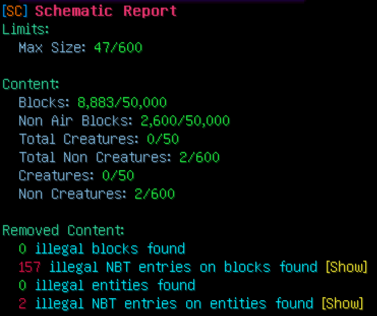

# Checking and fixing

This page explains what happens when you check or fix a schematic. The exact command syntax is on
[Commands and permissions](./commands.md).

## Where the files come from

All commands work inside the schematic folder of FastAsyncWorldEdit. You give the path of a file or folder relative
to that folder, for example `castle.schem` or `builds/castle.schem`. Paths that lead out of the schematic folder, for
example with `..`, are refused.

- Type the full file name, including `.schem` or `.schematic`. Tab completion helps you find it.
- Write a space in a name as `\_`. For example `old castle.schem` becomes `old\_castle.schem`.

The work runs in the background, so the server keeps running while a large schematic is checked.

## Check

`/schematicsanitizer check <schematic>` reads the file, applies your rules and shows a report. The file itself is not
changed.

Use it to see what a schematic contains before you paste it or hand it out.

## Fix

`/schematicsanitizer fix <schematic> [new name]` does the same as a check. Then it saves the cleaned schematic.

- Without a new name, the clean copy is saved next to the original as `<name>_new.schem`.
- With a new name, the clean copy gets that name, in the same folder as the original. `.schem` is added when the name
  does not end in `.schem` or `.schematic`. The name cannot contain folders.
- Add `-o` at the end to overwrite the original file instead.

A file that already exists under the new name is overwritten.

You get the same report as for a check.

## Fix a whole folder

`/schematicsanitizer fixbatch <directory>` fixes every `.schem` and `.schematic` file directly inside the folder.
Subfolders are not included.

- The clean files go into a new folder next to it, named after the folder with `_new` added. For `builds` that is
  `builds_new`. Each file is saved as `<name>.schem`.
- Add `-o` at the end to overwrite the original files instead. No `_new` folder is created then.
- To clean the schematic folder itself, add `-o`. Its `_new` folder would be outside the schematic folder.

For each file you get a short summary in chat. It lists the limits the file goes over and how many blocks, entities
and data tags were removed, or says that no problems were found. Click **[Full report]** to open the full report of
that file. Full reports from a batch stay available for 30 minutes after you last opened them.

## What gets removed

The rules come from `filter_settings.yml`. See [Configuration](./configuration.md) for every option and its default.

| What | When it is removed |
|---|---|
| Blocks | The block type is on the block blacklist. The spot is left empty. |
| Entities | The entity type is on the entity blacklist. |
| Creatures | Creature removal is turned on, or there are more creatures than the creature limit allows. |
| Non-creatures | Non-creature removal is turned on, or there are more non-creatures than the non-creature limit allows. |
| Entities of an unknown type | Always. These are entities the server cannot match to a known type. |
| Data tags on blocks and entities | The tag name is on the NBT blacklist, or the tag holds a text that contains an entry of the text blacklist. |

Data tags are searched at every depth. A blacklisted tag inside a chest item or a line of sign text is found as well.
Only the tag is removed. The block or entity that carried it stays.

**Creatures** are mobs that count as a creature in Bukkit, like animals, monsters and villagers. Everything else is a
**non-creature**: armor stands, item frames, paintings, minecarts and boats, and some mobs such as slimes, ghasts,
phantoms and bats.

### What is not changed

- The size of the schematic stays the same.
- The size limit and the block limits are only shown in the report. A schematic that goes over them keeps all its
  blocks.

## The report

After a check or a fix you get a report in chat. It has three parts:

- **File.** Hover over it to see the full path.
- **Limits and content.** The longest side of the schematic, the number of blocks and non-air blocks, and the number of
  creatures and non-creatures. Each value is shown next to its limit. The "total" counts include entities that were
  removed by the blacklist; the other counts do not.
- **Removed content.** How many blocks, block data tags, entities and entity data tags were removed. Click **[Show]**
  to page through the list. Each entry shows the position, the type and the reason.

The reasons you can see are:

| Reason | Meaning |
|---|---|
| Blacklist | The block or entity type is on a blacklist. |
| Creature | Creature removal is turned on. |
| Non Creature | Non-creature removal is turned on. |
| Creature Limit | There were more creatures than the limit allows. |
| Non Creature Limit | There were more non-creatures than the limit allows. |
| Unknown type | The server cannot match the entity to a known type. |
| Illegal Tag | The data tag name is on the NBT blacklist. |
| Text blacklist | The data tag holds a blacklisted text. |

The plugin remembers your latest report. Open it again with `/schematicsanitizer report`. It is kept until the server
restarts.
